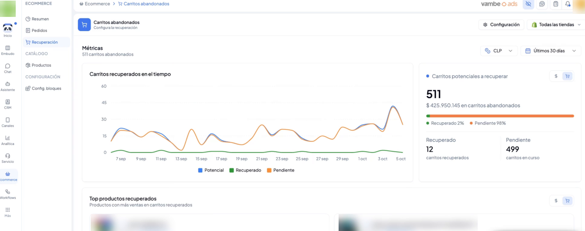
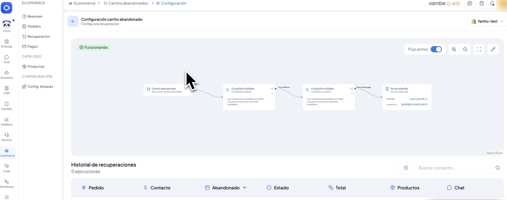
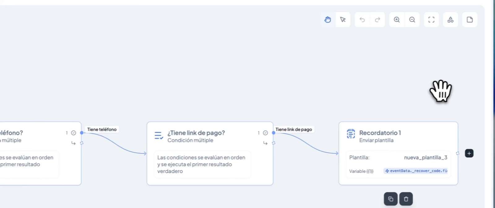
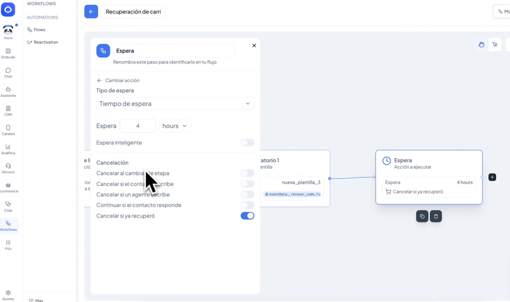
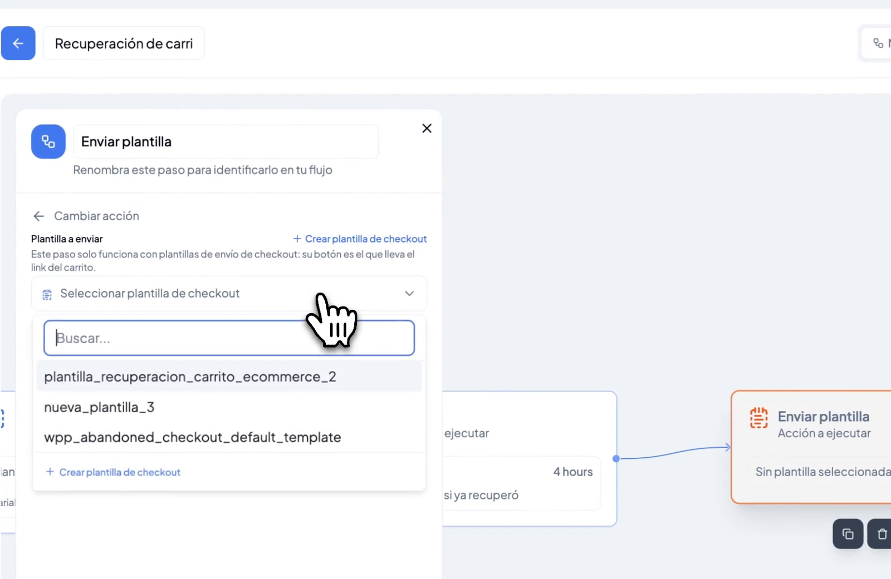
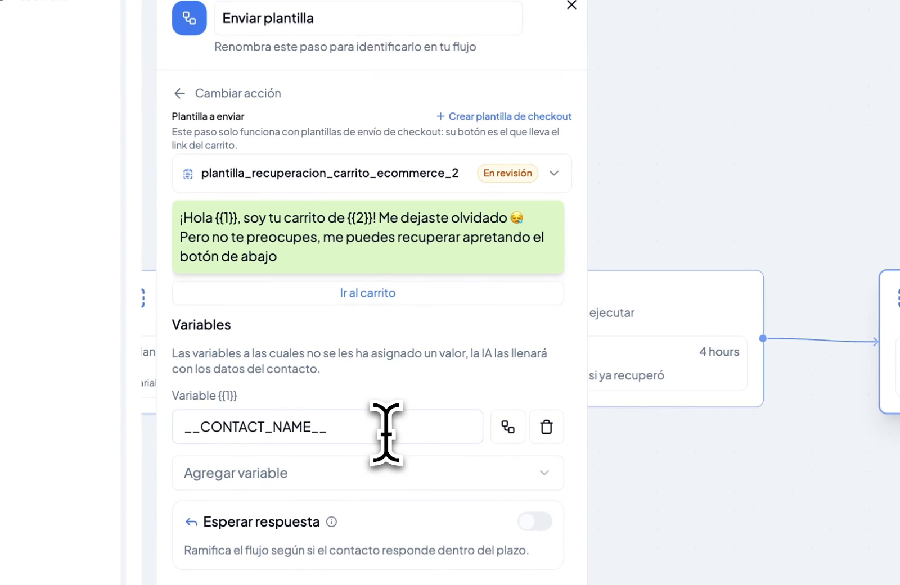
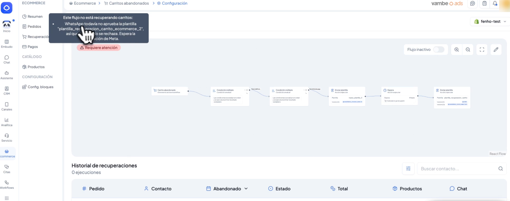

# Recuperación de carrito abandonado: configura tu flujo desde Vambe

Cada tienda conectada a Vambe tiene su propio flujo de recuperación de carritos abandonados, que puedes ver, activar y personalizar sin salir de Vambe. Detrás funciona como un **Workflow**, así que tienes libertad para elegir las plantillas, definir reintentos y enviar el mensaje solo cuando se cumplan las condiciones que tú decidas, por ejemplo, cierto monto de carrito.

Esta funcionalidad está disponible para tiendas **Shopify, WooCommerce, Jumpseller y Magento**. En este artículo aprenderás a leer las métricas de recuperación, a entender el flujo que viene listo y a ajustarlo a tu estrategia.


**Para entrar:** en el menú de la izquierda, ve a **E-commerce** y luego a **Recuperación**. Allí haz clic en **Configuración** y selecciona tu tienda.


***

## Métricas de recuperación

La pantalla de **Recuperación** resume cuánto dinero está volviendo a tu negocio gracias a los mensajes de seguimiento. Puedes filtrar por moneda, por período (por ejemplo, últimos 30 días) y por tienda.

<figure><figcaption></figcaption></figure>

Encontrarás tres bloques:

* **Evolución en el tiempo:** muestra los carritos como potencial, recuperados y pendientes. Puedes verla por monto o por cantidad de carritos.
* **Resumen del período:** el total de carritos abandonados, cuántos se recuperaron, cuántos siguen pendientes y el monto asociado a cada grupo.
* **Top productos recuperados:** los productos que más ventas han recuperado.

El link de checkout que se envía en cada recuperación lleva la información necesaria para atribuir la venta a Vambe de forma precisa.

***

## Tu flujo de recuperación

Al hacer clic en **Configuración** y elegir una tienda, verás su flujo de recuperación dibujado paso a paso, junto con el historial de ejecuciones en la parte inferior.

<figure><figcaption></figcaption></figure>

Desde esta pantalla puedes:

* **Activar o desactivar** el flujo con el interruptor **Flujo activo**.
* **Editarlo** con el ícono del lápiz para modificar cualquier paso.
* **Revisar su estado** con el indicador de salud que aparece arriba a la izquierda (por ejemplo, **Funcionando**).
* **Seguir cada recuperación** en el **Historial de recuperaciones**, donde ves el pedido, el contacto, la fecha de abandono, el estado, el total, los productos y el chat asociado.

Si tu tienda ya tenía la recuperación activa, encontrarás tu flujo creado y funcionando. Si es tu primera vez, puedes crearlo con un clic desde esta misma pantalla.

***

## Cómo funciona el flujo

El flujo parte con el evento **Carrito abandonado**, que envía tu tienda, y avanza por condiciones que cuidan que el mensaje sea posible de enviar.

<figure><figcaption></figcaption></figure>

Por defecto, el flujo incluye:

1. **¿Tiene teléfono?**: solo se escribe a clientes que dejaron un número válido.
2. **¿Tiene link de pago?**: solo se envía si existe el link de checkout para recuperar el carrito.
3. **Recordatorio 1**: un paso **Enviar plantilla** con el mensaje de recuperación.

Dentro del evento de carrito abandonado viaja mucha información (monto, moneda, proveedor de la orden, cantidad de productos, entre otros) que puedes usar en nuevas condiciones. Así puedes, por ejemplo, enviar una plantilla distinta según el valor del carrito.

***

## Agrega reintentos con el paso de espera

Si el primer recordatorio no logra recuperar la compra, puedes sumar un segundo intento. Para eso, agrega un paso **Espera** después del recordatorio y define el tiempo, por ejemplo, 4 horas.

<figure><figcaption></figcaption></figure>

El paso de espera viene con la opción **Cancelar si ya recuperó** activada: si el cliente compró durante la espera, no recibe más mensajes. También puedes cancelar el envío si el contacto cambia de etapa, si escribe o si un ejecutivo le escribe, y continuar el flujo si el contacto responde.

Después de la espera, agrega otro paso **Enviar plantilla** con el segundo mensaje.

***

## Plantillas de checkout

Este flujo solo acepta plantillas de tipo **checkout**, es decir, aquellas que incluyen el botón que lleva al carrito del cliente. Puedes crear todas las que necesites y usar una distinta en cada paso.

Al configurar un paso **Enviar plantilla**, elige tu plantilla en el selector. Si aún no tienes una, el atajo **Crear plantilla de checkout** te lleva a crearla.

<figure><figcaption></figcaption></figure>

### Variables de la plantilla

Cada variable de la plantilla (por ejemplo, \{{1\}} y \{{2\}}) se llena con un dato. Con **Agregar variable** puedes elegir, entre otros:

* El **nombre del contacto** al que se le escribe.
* El **nombre de la tienda**, que está dentro de la información del carrito abandonado (**Carrito abandonado → eventData**).

<figure><figcaption></figcaption></figure>

***

## Estado del flujo

El indicador de salud te avisa cuando algo impide que el flujo funcione. Si una plantilla todavía no está aprobada por WhatsApp, o si el flujo queda incompleto, verás el aviso **Requiere atención**, y el flujo se desactiva hasta que se resuelva. Al pasar el cursor sobre el aviso, Vambe te explica el motivo.

<figure><figcaption></figcaption></figure>

Por ejemplo, una plantilla que está **En revisión** te permite guardar el flujo, pero este se mantiene inactivo. Cuando WhatsApp aprueba la plantilla, el flujo se vuelve a activar.


La detección del carrito abandonado sigue llegando desde tu tienda. En Shopify necesitas tener configurado Flow y en WooCommerce, el plugin activado. Revisa las guías de [Shopify](recuperacion-de-carritos-abandonados-en-shopify.md) y [WooCommerce](como-activar-la-recuperacion-de-carritos-abandonados-en-woocommerce.md) para dejarlo listo.


***

## En resumen

La recuperación de carritos abandonados en Vambe te da visibilidad y control: ves cómo está funcionando cada tienda, ajustas las plantillas y los tiempos, y decides en qué casos enviar cada mensaje, todo desde un solo lugar y con un indicador que te avisa si algo necesita atención.
