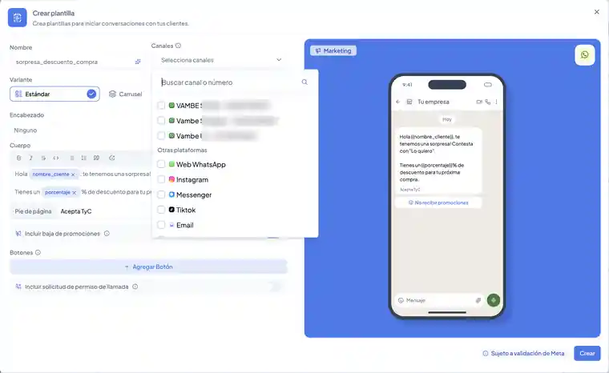
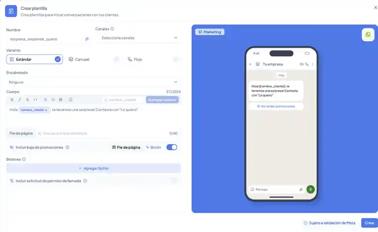

# Como crear plantillas

## Como crear plantillas

En esta guía aprenderás a **crear y configurar plantillas de WhatsApp en Vambe** para responder más rápido, abrir conversaciones cerradas (más de 24 h sin actividad), enviar campañas masivas cumpliendo las políticas de Meta o enviar mensajes rápidos. Todo el formulario cabe en una sola vista y, mientras escribes, ves en un teléfono cómo recibirá el mensaje tu cliente.

***

**¿Qué es una plantilla y para qué sirve?**

Una **plantilla** es un mensaje preaprobado por Meta que te permite:

* [Responder más rápido mensajes repetitivos.](https://academy.vambe.ai/canal/plantillas/como-enviar-mensajes-rapidos-y-plantillas)
* **Abrir conversaciones cerradas** (cuando pasaron más de 24 h desde el último mensaje del cliente).
* Iniciar chats desde cero (por ejemplo, leads que llegan desde formularios).
* Enviar **campañas masivas** a decenas, cientos o miles de contactos.
* Enviar mensajes de recordatorio de citas para agendamientos.

⚠️ Importante:

* Las plantillas de **WhatsApp** requieren aprobación de Meta.
* En **Instagram**, las plantillas no requieren aprobación y están listas de inmediato.

***

**Requisitos previos**

Para usar plantillas necesitas:

* Tener un [**número de WhatsApp Business API**](https://academy.vambe.ai/canal/conexion-de-canales-de-vambe/como-conectar-whatsapp-api-oficial) o [número híbrido conectado](https://academy.vambe.ai/canal/conexion-de-canales-de-vambe/guia-de-conexion-whatsapp-api-metodo-qr) en Vambe.
* Tener un [**método de pago activo**](https://academy.vambe.ai/canal/configuracion-en-meta/como-agregar-un-metodo-de-pago-y-configurar-el-perfil-de-tu-numero-de-whatsapp-api) en tu cuenta de WhatsApp dentro de Meta (obligatorio para enviar plantillas y campañas).

***



**Ingresar a la sección de Plantillas**

* En Vambe, ve al menú izquierdo.
* Haz clic en **Canales**.
* En el submenú, selecciona **Plantillas**.
* Haz clic en **Crear plantilla**.




**Completar el formulario**

Se abre una sola ventana con todo lo que necesitas: a la izquierda configuras la plantilla y a la derecha ves la vista previa del teléfono, que se va actualizando a medida que escribes.

<figure><figcaption></figcaption></figure>

**Nombre**

Puedes escribir el nombre que prefieras. Si no lo defines, Vambe te sugiere uno automáticamente a partir del contenido de tu mensaje.

* Debe ser técnico, sin espacios ni caracteres especiales.
* Ejemplos: `recordatorio_cita`, `seguimiento_pago`, `promo_blackfriday`

**Canales**

Desplega el selector **Canales** y marca los canales donde quieres usar la plantilla. Puedes buscar por nombre o por número.

<figure><figcaption></figcaption></figure>

**Variante**

Elige entre **Estándar**, **Carrusel** o **Flujo**. Esta guía explica la variante **Estándar**, la más usada para mensajes de texto con botones opcionales.

**Encabezado (opcional)**

Puede ser texto, imagen, video o documento PDF. Si no lo necesitas, déjalo en **Ninguno**.

**Cuerpo del mensaje**

Es el contenido principal, con un máximo de 1024 caracteres. Usa la barra de formato para dar estilo al texto (negrita, cursiva, tachado, listas, citas y emojis).

Recomendaciones:

* Claro y directo.
* Profesional pero cercano.

**Pie de página (opcional)**

Texto breve de hasta 60 caracteres, generalmente informativo. Por ejemplo: _Acepta TyC_.



**Agregar variables y completar sus ejemplos**

Las variables te permiten personalizar el mensaje para cada cliente. Hay dos formas de agregarlas:

* Escribe el nombre de la variable en el campo junto a **Agregar variable** (por ejemplo, `nombre_cliente`) y haz clic en el botón.
* O escríbela directamente en el texto entre llaves dobles, como `{{nombre_cliente}}`.

En el cuerpo, cada variable aparece como una etiqueta que puedes quitar con la **x**.

Ejemplo:

* `Hola {{nombre_cliente}}, tu cita está agendada para el {{fecha}}.`

Tip: usa nombres claros para cada variable (`nombre_cliente`, `fecha`, `direccion`), así será más fácil saber qué dato corresponde a cada una cuando envíes la plantilla o configures una campaña.

**Ejemplos para la revisión de Meta**

Antes de crear la plantilla, debes completar un valor de ejemplo para cada variable. Esto permite que Meta entienda el contexto del mensaje.

Ejemplo:

* `nombre_cliente` = Felipe
* `fecha` = 25 de enero
* `direccion` = Av. Kennedy 1234



**Categoría y baja de promociones**

No necesitas elegir la categoría: al escribir tu mensaje, la IA de Vambe detecta si corresponde a **Marketing** o a **Utilidad** y te la muestra arriba de la vista previa. La categoría se asigna automáticamente y no se puede cambiar manualmente.

Si la plantilla es de **Marketing**, Vambe activa por defecto la opción **Incluir baja de promociones**, para que tus clientes puedan dejar de recibir promociones cuando quieran. Puedes mostrarla como **Pie de página** o como **Botón**, y en la vista previa verás cómo queda.

<figure><figcaption></figcaption></figure>

_(Meta puede ajustar la categoría si considera que no coincide con el contenido del mensaje.)_



**Botones y permiso de llamada (opcionales)**

En **Botones**, haz clic en **Agregar botón** para sumar:

* **Respuestas rápidas**
* **Botón con URL**
* **Botón para llamar por teléfono**

Al final del formulario también encontrarás **Incluir solicitud de permiso de llamada**. Esta opción solo aparece si tienes activadas las llamadas de WhatsApp en tu cuenta.



**Crear y esperar la aprobación de Meta**

Revisa la vista previa y haz clic en **Crear**. Como indica el aviso junto al botón, la plantilla queda sujeta a validación de Meta.

Qué ocurre después:

* El estado de la plantilla será **Pendiente** mientras Meta la evalúa.
* Una vez aprobada, quedará **lista para usar** en:
  * Envíos manuales
  * Mensajes rápidos
  * Acciones automáticas
  * Campañas

Para actualizar el estado:

* Haz clic en **Sincronizar**.
* Meta suele responder en minutos.




***

### Uso de las plantillas

#### ¿Cuándo se debe usar una plantilla?

Debes utilizar una plantilla cuando:

* **Ya pasaron más de 24 horas** desde el último mensaje del cliente (chat cerrado).
* **Necesitas iniciar una conversación desde cero**, por ejemplo, al contactar leads de formularios o bases externas.
* **Deseas enviar campañas masivas** a decenas, cientos o miles de contactos.
* **Quieres responder de forma rápida** con mensajes predefinidos.

⚠️ Importante: La conversación solo se abre cuando **el cliente responde**. Por eso, siempre se recomienda incluir **toda la información clave en el primer mensaje de la plantilla**, evitando depender de respuestas adicionales.

***

#### 💲 Costo por envío de plantillas

El envío de plantillas tiene un costo definido por Meta. Cada vez que envías una plantilla para iniciar o reactivar una conversación (fuera de la ventana de 24 horas), se genera un cobro según:

* **El país del cliente:** Las tarifas varían dependiendo de la región geográfica del número receptor.
* **El tipo de conversación:** El costo se determina por la categoría de la plantilla (marketing o utilidad).
* **Las tarifas vigentes:** Los precios son establecidos directamente por Meta y pueden sufrir ajustes.

Este cobro no depende de si el cliente responde o no; se genera de forma automática al momento de enviar la plantilla desde Vambe.

👉 Te recomendamos revisar periódicamente las [tarifas oficiales de Meta](https://business.whatsapp.com/products/platform-pricing?lang=es_LA) para entender el impacto en tu facturación.

***

#### Plantillas en acciones automáticas

Las plantillas también pueden usarse en:

* Seguimientos automáticos
* Reenvíos
* Flujos de nurturing
* Mensajes programados

Solo debes elegir la plantilla que corresponda dentro de la acción automática que configures.

***

#### Buenas prácticas

* Sé breve y directo.
* Usa variables, pero siempre asegúrate de que tendrán valor.
* No intentes “camuflar” mensajes promocionales como utilidad.
* Usa nombres técnicos simples.
* Antes de campañas masivas, prueba enviándote la plantilla a ti.
* Evita links sospechosos o claims engañosos (Meta los rechaza).

***

### Solución de problemas frecuentes

❌ Meta rechazó mi plantilla

* Ajusta el texto de tu mensaje y vuelve a crearla.
* Evita promociones agresivas, claims falsos o confusos.

❌ No aparece WhatsApp como canal

* Verifica que tu número WhatsApp Business API esté correctamente conectado.

❌ Las variables aparecen vacías

* Debes mapearlas al momento de enviar o configurar la campaña.

❌ El estado no actualiza

* Pulsa **Sincronizar** y espera unos minutos.

