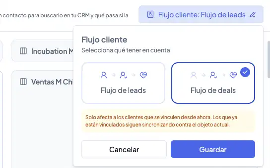
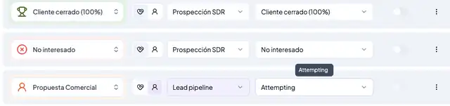

# Cómo conectar y configurar tu CRM

Vambe permite integrarse nativamente con los CRMs más importantes del mercado para mantener tu base de datos y tu equipo de ventas alineados.

**Integraciones disponibles:**

* HubSpot (Deals, Leads y Tickets)
* Pipedrive
* Salesforce
* Zoho (CRM y Desk)
* ActiveCampaign
* Odoo CRM

A continuación, te explicamos paso a paso cómo realizar la conexión y la configuración avanzada de sincronización.


Si tienes dudas que puedo conectar con mi CRM, puedes revisarlo aquí


***

#### 1. Conexión Inicial

1. En el menú lateral izquierdo, ve a la sección **CRM**.
2. Despliega el menú de **Ajustes** y selecciona **Integraciones**.
3. Verás el listado de CRMs disponibles. Haz clic en Conectar en la tarjeta de tu CRM (ej: Pipedrive, HubSpot, etc.).


¿Vas a conectar **Odoo CRM**? A diferencia de otros CRMs, Odoo requiere que generes una Llave de API manualmente antes de este paso. Revisa primero [cómo obtener las credenciales de Odoo CRM](como-obtener-las-credenciales-de-odoo-crm.md).


4. Sigue los pasos de autenticación de tu plataforma externa.
5. Una vez conectado, volverás a Vambe. Si no ves la integración activa inmediatamente, **actualiza la página.**
6. Haz clic en el icono de Lápiz (Editar) para entrar al panel de configuración.

<figure><figcaption></figcaption></figure>

***

#### 2. Sincronización General

En la primera pestaña **Sincronizar**, encontrarás tres opciones clave que permiten a Vambe "leer" la estructura de tu CRM:

* **Sincronizar Campos**: Detecta automáticamente los campos personalizados de tu CRM para que puedas usarlos en Vambe.
* **Sincronizar Agentes**: Importa los usuarios de tu CRM para asignar dueños a los contactos.
* **Sincronizar Etiquetas**: Trae las etiquetas existentes en tu CRM.

<figure><figcaption></figcaption></figure>

***

#### 3. Atributos de Contacto (Reglas de Envío)

Esta sección es crítica. Aquí defines los **requisitos mínimos** para que un contacto se envíe al CRM.

* **¿Cómo funciona?** Seleccionas un embudo y defines qué campos son obligatorios (ej: RUT, Email).
* **La Regla:** Si el contacto **NO tiene este dato** (ni la IA ni el humano lo rellenaron), Vambe **NO enviará** el contacto al CRM para evitar ensuciar tu base de datos con leads vacíos.

1. Activa el interruptor del embudo que deseas configurar.
2. Haz clic en el botón **(+)** y selecciona el campo obligatorio (ej: Email).

<figure><figcaption></figcaption></figure>

***

#### 4. Configuración de Contacto

Aquí definimos cómo busca, importa y actualiza Vambe la información.

**A. Configuración de Búsqueda**

Define el criterio único para evitar duplicados. Vambe buscará en tu CRM si el contacto ya existe usando estos campos (ej: Email o Teléfono). Si lo encuentra, lo actualiza; si no, lo crea.

<figure><figcaption></figcaption></figure>

**B. Configuración de Importación**

Define qué datos debe traer **Vambe desde el CRM hacia adentro**. Puedes activar:

* Sincronizar asignación de agentes.
* Sincronizar etiquetas.
* Sincronizar campos de contacto.
* Sincronizar Último Negocio: Importante para traer el contexto de ventas anteriores.

<figure><figcaption></figcaption></figure>

**C. Webhooks (Bidireccionalidad)**

Activa esta opción para que, cuando algo cambie en tu CRM (ej: cambias una etapa en Pipedrive), se actualice automáticamente en Vambe en tiempo real.

<figure><figcaption></figcaption></figure>

***

#### 5. Mapeo de Campos

Es momento de conectar los cables. Debes decir qué campo de Vambe corresponde a qué campo de tu CRM.

* **Campos de Contacto:** Asocia datos personales (Nombre, Rut, Email).

<figure><figcaption></figcaption></figure>

* **Atributos del Deal (Trato/Ticket):** Asocia datos de la venta (Monto, Producto de interés, Dirección de despacho). Esto es vital para que el negocio se cree con información valiosa en tu CRM.

<figure><figcaption></figcaption></figure>

***

#### 6. UTMs (Rastreo de Marketing)

Si realizas publicidad digital, puedes mapear los parámetros UTM (Source, Medium, Campaign) para que se envíen al CRM y puedas medir el ROI de tus campañas. Selecciona el valor UTM (ej: `utm_source`) y asócialo al campo correspondiente en tu CRM.

<figure><figcaption></figcaption></figure>

***

#### 7. Etapas (El disparador)

Esta es la configuración más importante para la automatización. Aquí decides **cuándo y dónde** se envía el lead.

Debes configurar la siguiente lógica:

1. **Etapa Vambe**: Selecciona la etapa de tu embudo en Vambe que servirá de "gatillo" (ej: Cuando entre a "Cotización Enviada").
2. **Pipeline CRM**: Selecciona a qué embudo de tu CRM irá.
3. **Etapa CRM**: Selecciona en qué etapa exacta caerá en tu CRM.
4. **Crear Trato (Switch):**
   * **Activado**: Crea el Contacto + el Negocio (Deal/Oportunidad).
   * **Desactivado**: Solo crea o actualiza el Contacto (sin crear oportunidad de venta).

<figure><figcaption></figcaption></figure>

**Salesforce: flujo de leads con conversión a contacto y oportunidad**

En Salesforce, un contacto puede entrar como **Lead** y, cuando está listo para venderse, convertirse en un **Contacto con su Oportunidad (Opportunity)**. Vambe acompaña ese recorrido con el **Flujo de leads**: tus contactos viajan como leads, como siempre, y tú defines en qué momento del embudo se convierten.

Cuando la conversión ocurre, Vambe marca el lead en un estado terminal de Salesforce y crea el contacto con su oportunidad. Así tu equipo comercial recibe la oportunidad en el momento exacto en que el prospecto avanzó lo suficiente en tu embudo.


**Para entrar:** en el menú lateral izquierdo, ve a **CRM**, abre la integración de Salesforce con el icono de Lápiz y selecciona **Crear en el CRM**. Luego, en la pestaña **Cuáles se crean**, haz clic en el botón **Flujo cliente** (arriba a la derecha).


**Paso 1: elige el flujo y el estado de conversión**

En el panel **Flujo cliente** selecciona **Flujo de leads**. Debajo encontrarás el campo **Conversión del Lead**, donde eliges el estado que recibirá el lead cuando una etapa con **Crear Trato** lo convierta en Contacto con su Oportunidad. Por ejemplo, **Closed - Converted**. Luego haz clic en **Guardar**.

<figure><figcaption></figcaption></figure>

**Paso 2: mapea tus etapas**

Ve a la sección **Etapas** y asocia cada etapa de tu embudo en Vambe con una etapa de Salesforce. Las etapas que mantienes como lead se asocian al pipeline **Lead (estado)**, y la etapa donde quieres que ocurra la conversión se asocia a una etapa que no sea de lead, con **Crear Trato** activado.

<figure><figcaption></figcaption></figure>

Por ejemplo:

* **Inicial**: Lead (estado) / Open - Not Contacted
* **Envío de cotización**: Lead (estado) / Working - Contacted
* **Agendador**: Proceso de Ventas 2 / Qualification, con **Crear Trato** activado


Para que la conversión se realice, el contacto debe llegar a una etapa de Vambe que tenga mapeada una etapa de Salesforce que no sea de lead y que tenga activada la opción **Crear Trato**.


**HubSpot: flujo de leads con creación de deal**

En HubSpot, los **Leads** son un objeto pensado para Marketing y para prospectos que todavía están en las primeras etapas del embudo, antes de convertirse en un negocio concreto. Con el **Flujo de leads**, Vambe crea y mueve leads en HubSpot mientras el prospecto se califica, y crea el **deal** solo cuando la oportunidad se vuelve un negocio real. Así tu equipo de Marketing sigue el avance de cada prospecto y tu equipo comercial recibe en su pipeline de deals únicamente las oportunidades que ya están listas.


**Para entrar:** en el menú lateral izquierdo, ve a **CRM**, abre la integración de HubSpot con el icono de Lápiz y selecciona **Crear en el CRM**. Luego, en la pestaña **Cuáles se sincronizan**, haz clic en el botón **Flujo cliente** (arriba a la derecha).


**Cómo viaja un contacto en el Flujo de leads**



**Se crea el contacto**

Cuando un contacto nuevo entra a Vambe, Vambe lo crea en HubSpot como un contacto normal, con su nombre, teléfono y email. En esta etapa, HubSpot todavía no lo trata como lead.



**Se crea el lead**

Cuando el ticket entra a la primera etapa de Vambe mapeada a Leads, Vambe crea un **Lead** en HubSpot asociado a ese contacto, en el pipeline y la etapa de Leads que configuraste. Desde ese momento ambos conviven: el contacto guarda quién es la persona y el lead representa esta oportunidad concreta de venta en curso.



**El lead avanza en la calificación**

Cada vez que el ticket cambia de etapa en Vambe, el lead se mueve a la etapa correspondiente de tu pipeline de Leads. Mientras no exista un deal, las notas, tareas y el owner se registran en el contacto.



**Se crea el deal**

Cuando el ticket llega a una etapa de Vambe mapeada a un pipeline de deals con **Crear Trato** activado, la oportunidad pasa a ser un negocio real. Antes de crear el deal, Vambe revisa si un vendedor ya calificó ese lead manualmente en HubSpot: si ya existe un deal creado desde ese lead, Vambe lo utiliza en lugar de crear otro. Si no existe, Vambe crea el deal en el pipeline y la etapa configurados para esa etapa de Vambe.



**El lead queda asociado al deal**

Vambe asocia el lead al deal como su deal principal. Así, en HubSpot puedes ver de qué lead nació cada negocio.



Si el mismo contacto vuelve a comprar más adelante, Vambe crea un nuevo lead. El contacto es uno solo, pero cada ciclo de venta tiene su propio lead.


El deal solo se crea cuando el ticket entra a una etapa de Vambe mapeada a un pipeline de deals que tenga activada la opción **Crear Trato**. Mientras el ticket avance por etapas de Leads, en HubSpot solo existirán el contacto y su lead.


**Paso 1: elige el Flujo de leads**

En el panel **Flujo cliente** encontrarás dos opciones: **Flujo de leads** y **Flujo de deals**. Selecciona **Flujo de leads** y haz clic en **Guardar**.

<figure><figcaption></figcaption></figure>


El flujo que elijas aplica a los contactos que se vinculen desde ese momento. Los contactos que ya están vinculados siguen sincronizando contra el objeto con el que fueron creados.


**Paso 2: indica qué etapas van a Leads y cuáles a deals**

Ve a la sección **Etapas**. Junto a cada etapa de Vambe encontrarás un selector con dos íconos: el ícono de persona asocia la etapa al pipeline de **Leads** y el otro ícono la asocia a un pipeline de **deals**. Las etapas asociadas a Leads se muestran en color morado, y las asociadas a deals mantienen el color normal.

<figure><figcaption></figcaption></figure>

**Paso 3: elige el pipeline y la etapa en HubSpot**

Para las etapas asociadas a Leads, selecciona el pipeline de Leads y la etapa que tendrá el lead en HubSpot (por ejemplo, **Attempting**). Para la etapa donde quieres que nazca el negocio, selecciona tu pipeline de deals con su etapa y activa **Crear Trato**.

Por ejemplo:

* **Nuevo contacto**: Lead pipeline / New
* **Propuesta Comercial**: Lead pipeline / Attempting
* **Reunión agendada**: Prospección SDR / Reunión agendada, con **Crear Trato** activado

***

#### 8. Automatización Inversa: Trigger de Workflow por Cambio de Etapa CRM

Además de enviar información desde Vambe a tu CRM, ahora puedes configurar **Workflows en Vambe** que se activen automáticamente cuando un contacto **cambia de etapa directamente en tu CRM**. Esta funcionalidad simplifica significativamente la automatización y te permite reaccionar a eventos clave sin la necesidad de complejos flujos en tu sistema CRM.

**Beneficios clave:**

* **Automatización Directa:** Ejecuta acciones en Vambe (ej. enviar mensajes, asignar ejecutivos) tan pronto como una etapa cambia en HubSpot, Pipedrive o Salesforce.
* **Optimización de Costos:** Permite a usuarios de planes básicos de CRM (como HubSpot Starter) automatizar acciones que antes requerían planes más avanzados y costosos.
* **Flexibilidad:** El trigger ofrece dos opciones para gestionar los contactos:
  * **Buscar solo contactos existentes en Vambe:** Activa el workflow solo si el contacto ya está registrado en Vambe.
  * **Buscar o crear el contacto si no existe:** Si el contacto no está en Vambe, se creará automáticamente para poder ejecutar el workflow.

Para configurar este trigger, dirígete a la sección de Workflows en Vambe y selecciona la opción **"Cambio de Etapa CRM"** como gatillante.

***

#### 9. Ajustes Finales

En la pestaña Ajustes, podrás ver el estado de la sincronización o **Eliminar** la integración si necesitas desconectar el CRM.


⚠️ **Advertencia**: Si eliminas el CRM, se perderá la configuración de mapeo realizada.

