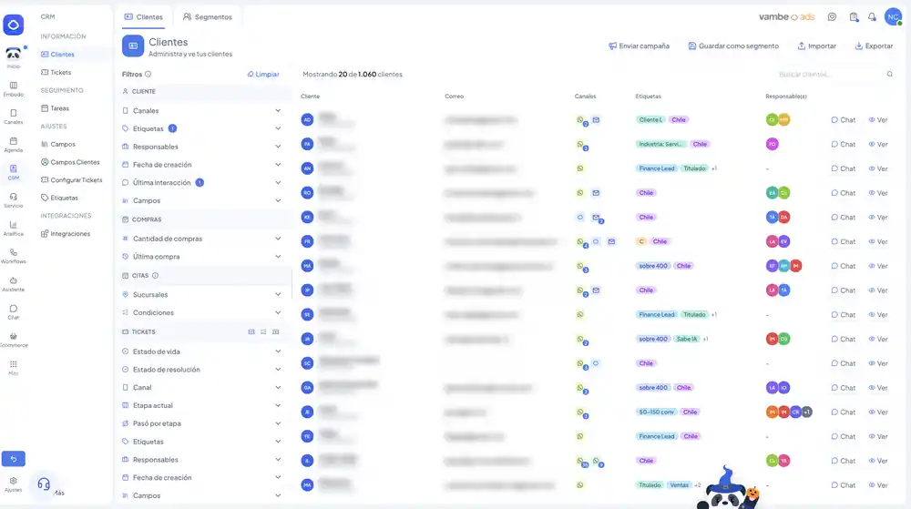
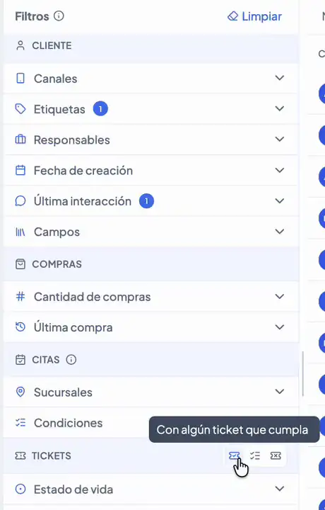
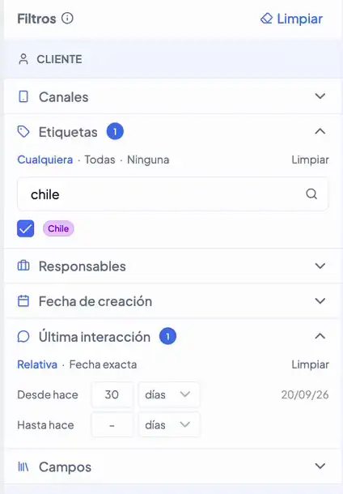
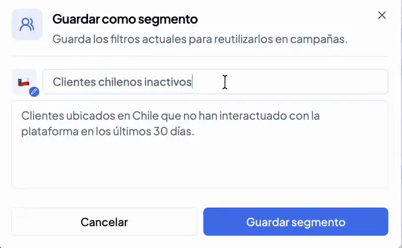
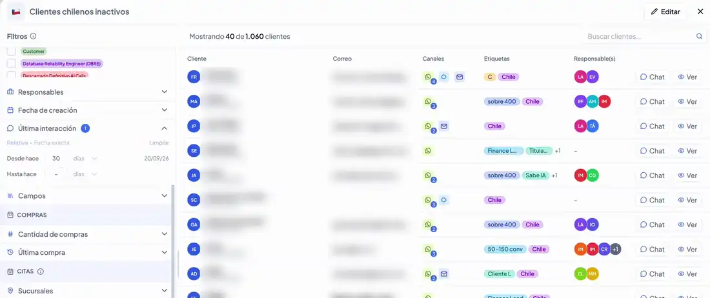
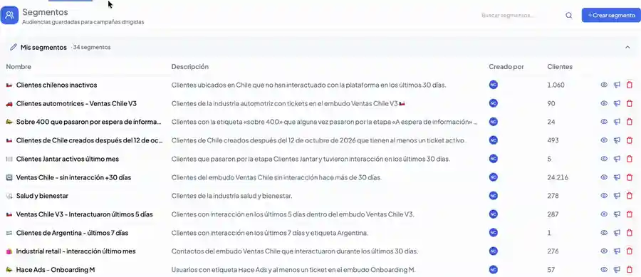
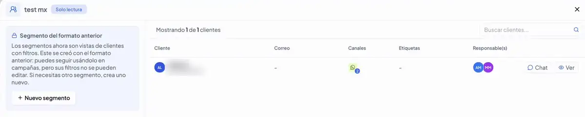
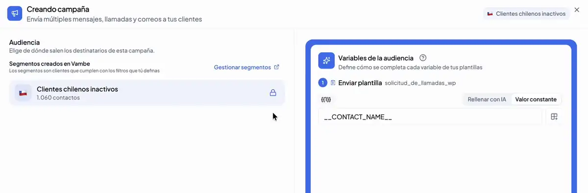
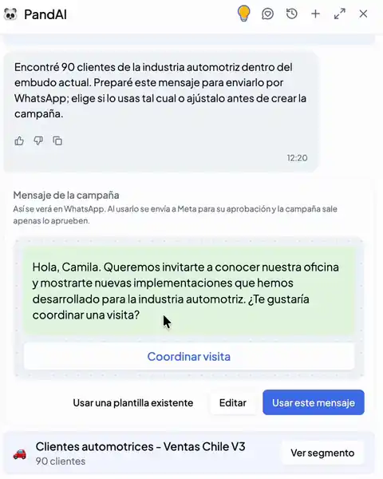
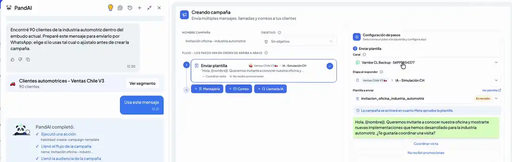

# Clientes y Segmentos: filtra tu base y conviértela en audiencias para tus campañas

En Vambe, un segmento es una **vista filtrada de tus clientes**. Partes de toda tu base, aplicas los filtros que describen al grupo que te interesa —por ejemplo, clientes con la etiqueta «Chile» que no interactúan contigo hace más de 30 días— y guardas esa vista para volver a ella o para enviarle una campaña cuando lo necesites.

Los segmentos son dinámicos: no guardan una lista fija de personas, sino los criterios. Cada vez que abres un segmento o que una campaña lo calcula, Vambe busca a todos los clientes que cumplen esos criterios en ese momento, así que la audiencia siempre está al día. En esta guía verás cómo filtrar tu base, guardar un segmento, enviarle una campaña y pedirle a PandAI que haga todo el proceso por ti.

> Para entrar: en el menú de la izquierda, ve a **CRM** y luego a **Clientes**. En la parte superior encontrarás dos pestañas: **Clientes**, con toda tu base, y **Segmentos**, con las vistas que has guardado.

<figure><figcaption></figcaption></figure>

***

## Filtra tu base de clientes

La pestaña **Clientes** muestra a todas las personas registradas en tu cuenta, con sus canales, etiquetas y ejecutivos responsables. A la izquierda está el panel de **Filtros**: a medida que los aplicas, la lista se actualiza y el contador superior te indica cuántos clientes cumplen los criterios (por ejemplo, «Mostrando 20 de 1.060 clientes»).

### Qué puedes filtrar

Los filtros están organizados en cuatro grupos:

* **Cliente**: canales, etiquetas, ejecutivos responsables, fecha de creación, última interacción y campos personalizados.
* **Compras**: cantidad de compras y fecha de la última compra. Disponible para cuentas de e-commerce.
* **Citas**: sucursales y condiciones de las citas. Disponible para cuentas de agendamiento.
* **Tickets**: atributos de los tickets del cliente, como estado de vida, estado de resolución, canal, etapa actual, si pasó por una etapa, etiquetas, responsables, fecha de creación y campos.

<figure><figcaption></figcaption></figure>

### Cómo se combinan los filtros

Todos los filtros que aplicas se suman entre sí: un cliente aparece en la lista solo si cumple con **todos** ellos. Si filtras por la etiqueta «Chile» y por una última interacción de hace más de 30 días, verás únicamente a los clientes que tienen esa etiqueta **y** que llevan ese tiempo sin interactuar.

Dentro de cada filtro, en cambio, decides cómo se evalúan las opciones que eliges:

* **Cualquiera**: basta con que el cliente cumpla al menos una de las opciones seleccionadas.
* **Todas**: el cliente debe cumplir con todas las opciones seleccionadas.
* **Ninguna**: el cliente no debe cumplir ninguna de las opciones seleccionadas.

Así, por ejemplo, puedes buscar clientes que tengan la etiqueta «Chile» o «México», clientes que tengan ambas etiquetas a la vez, o clientes que no tengan ninguna de ellas. En los filtros de fecha puedes elegir entre un rango **Relativo** (desde hace y hasta hace cierta cantidad de días) o una **Fecha exacta**.

<figure><figcaption></figcaption></figure>

### Filtros sobre los tickets del cliente

Un mismo cliente puede tener varios tickets, en distintos embudos y canales. Por eso, junto al título **Tickets** del panel encontrarás unos íconos que definen cómo se aplican esos filtros: puedes indicar que basta con que **algún ticket** del cliente cumpla con los criterios, o exigir que **todos sus tickets** los cumplan. Esto te permite, por ejemplo, distinguir entre clientes que tienen al menos un ticket en una etapa determinada y clientes cuyos tickets están todos en esa etapa.

***

## Guarda tu vista como segmento

Cuando encuentras un grupo que quieres seguir de cerca o contactar más adelante, no necesitas anotarlo ni exportarlo. Con los filtros aplicados, haz clic en **Guardar como segmento**, en la parte superior derecha.

Vambe te propone automáticamente un nombre y una descripción a partir de los filtros activos —por ejemplo, «Clientes chilenos inactivos: clientes ubicados en Chile que no han interactuado en los últimos 30 días»—. Puedes ajustarlos si lo necesitas y luego haz clic en **Guardar segmento**.

<figure><figcaption></figcaption></figure>

Al guardarlo, se abre la vista del segmento: la lista de clientes que lo componen y, a la izquierda, los filtros que lo definen. En esta vista los filtros aparecen bloqueados para que no los modifiques por accidente; si quieres cambiarlos, haz clic en **Editar**, en la esquina superior derecha.

<figure><figcaption></figcaption></figure>

***

## Consulta y administra tus segmentos

En la pestaña **Segmentos** encontrarás el listado **Mis segmentos**, con todas las vistas guardadas en tu cuenta. Para cada una verás su nombre, la descripción de los criterios que la definen, quién la creó y la cantidad de clientes que la cumplen en este momento.

Desde cada fila puedes:

* **Ver** el segmento, para revisar quiénes lo componen y cuáles son sus filtros.
* **Enviar una campaña** directamente a ese grupo.
* **Eliminar** el segmento.

También puedes buscar un segmento por su nombre o crear uno nuevo con **+ Crear segmento**, que te lleva a la vista de clientes para que apliques los filtros.

<figure><figcaption></figcaption></figure>


Como un segmento es solo una vista de clientes con filtros, trabajar entre las pestañas Clientes y Segmentos es natural: lo que filtras en una lo guardas y lo reutilizas en la otra.


### Segmentos de solo lectura

Algunos segmentos creados con un formato anterior aparecen en el listado con la etiqueta **Solo lectura**. Corresponden a reglas que no tienen equivalente en los filtros actuales. Puedes abrirlos para ver a sus clientes y seguir usándolos en tus campañas, pero sus filtros no se pueden editar. Si necesitas un grupo distinto, crea un segmento nuevo con **+ Nuevo segmento**.

<figure><figcaption></figcaption></figure>

***

## Envía una campaña a un segmento

El objetivo de un segmento es poder contactar a ese grupo en el momento oportuno. Para hacerlo, haz clic en el ícono de **Enviar campaña** en la fila del segmento. También encontrarás el botón **Enviar campaña** en la parte superior de la vista Clientes.

Se abrirá el formulario de creación de campaña con el segmento ya cargado: lo verás en la parte superior y, en el paso **Audiencia**, aparecerá fijo como destinatario. Solo te queda armar el flujo de contacto, definir las variables de tus plantillas y elegir cómo y cuándo sale el envío.

<figure><figcaption></figcaption></figure>


El segmento es dinámico hasta que confirmas la audiencia de la campaña. En ese momento se calculan los clientes que cumplen los criterios y la audiencia de esa campaña queda fija.


Para conocer el detalle de cada paso de una campaña —flujo, audiencia y envío— revisa [Campañas: contacta a tus clientes con un flujo omnicanal](https://academy.vambe.ai/canal/campanas/campanas-contacta-a-tus-clientes-con-un-flujo-omnicanal).

***

## Crea segmentos y campañas con PandAI

No necesitas conocer cada filtro ni cada pantalla para llegar a tus clientes. Basta con contarle a **PandAI**, en tus palabras, a quién quieres escribirle y qué quieres decirle. PandAI puede crear el segmento, la plantilla de WhatsApp y la campaña en una misma conversación.

Por ejemplo, desde un embudo puedes escribirle: «Envía un mensaje a todos nuestros clientes de la industria automotriz en este embudo, invitándolos a conocer nuestra oficina, ya que queremos mostrarles nuevas implementaciones que hemos desarrollado». A partir de esa instrucción, PandAI:

1. **Construye el segmento** con los criterios que describiste y te muestra cuántos clientes lo cumplen, con un acceso directo para revisarlo (**Ver segmento**).
2. **Propone el mensaje** de la campaña tal como se verá en WhatsApp. Puedes usarlo tal cual (**Usar este mensaje**), ajustarlo (**Editar**) o elegir una plantilla que ya tengas aprobada (**Usar una plantilla existente**).
3. **Completa el formulario de campaña**: elige el segmento, crea el paso de envío de la plantilla, selecciona el canal de WhatsApp del embudo y la etapa a la que llegará el ticket cuando el cliente responda.

<figure><figcaption></figcaption></figure>

Antes de crear la campaña, PandAI te pide confirmación. Revisa que todo coincida con lo que conversaron y, cuando esté listo, la campaña queda creada. Desde el último paso del formulario eliges cómo y cuándo enviarla.

<figure><figcaption></figcaption></figure>


Si PandAI crea una plantilla nueva, esta se envía a Meta para su aprobación. Puedes crear la campaña de inmediato: se activará en cuanto Meta apruebe la plantilla.


***

## Segmentos RFM automáticos

Además de los segmentos que creas tú —con PandAI o manualmente—, cada tienda de e-commerce conectada cuenta con 11 segmentos que Vambe calcula y actualiza solo, sin que definas ninguna regla. Aparecen agrupados bajo la etiqueta **RFM · automático** en el listado de segmentos.

<figure><figcaption></figcaption></figure>

### Qué es RFM

RFM resume a cada comprador en tres preguntas:

* **Recencia:** ¿hace cuánto compró?
* **Frecuencia:** ¿cuántas veces ha comprado?
* **Monto:** ¿cuánto gasta por compra?

Cada una de las tres recibe una nota del 1 al 5, y la combinación de esas tres notas determina en qué segmento cae el comprador.

### Cómo se calcula

Las notas son relativas a cada tienda, no absolutas: un ticket de $50.000 puede considerarse alto en una tienda y bajo en otra, así que cada tienda se compara únicamente consigo misma. Los cortes entre notas quedan fijos una vez calculados, lo que permite ver si un cliente mejora o empeora de segmento con el tiempo.

<figure><figcaption></figcaption></figure>

El mapa completo de los 11 segmentos se lee así:

* Los tres bloques agrupan por frecuencia de compra: compra seguido (F4-5), volvió a comprar (F2-3), o hizo una sola compra (F1).
* Dentro de cada bloque, mientras más arriba, más reciente es la última compra (de R1 a R5); mientras más a la derecha, más gasta el cliente (de M1 a M5).
* Cada celda representa un tipo de cliente, y su color indica a qué segmento pertenece. Cada cliente cae en un solo segmento, por lo que los 11 segmentos siempre suman el total de compradores de la tienda.

### Limitaciones a tener en cuenta


⚠️ Los segmentos RFM tienen algunas condiciones propias, distintas a las de los segmentos que creas manualmente:

* Solo están disponibles para tiendas de e-commerce conectadas que tengan al menos 200 compradores.
* Se actualizan una vez por semana, no en tiempo real.
* Son de solo lectura: no se pueden editar ni eliminar.
* En la mayoría de las tiendas, **Recompra activa** y **Recompra detenida** van a aparecer con 0 contactos. Esto es esperado: significa que esa tienda todavía no tiene suficiente recompra como para separar ese nivel, y no indica un error.


### Cómo se usan

Una vez calculados, los segmentos RFM se usan exactamente igual que cualquier otro segmento: puedes ver los clientes que los componen y enviarles una campaña directamente desde el listado.

***

## En resumen

Clientes y Segmentos funcionan como una sola herramienta: filtras tu base con la combinación de criterios que necesites —atributos del cliente, sus tickets, sus compras o sus citas—, guardas esa vista como segmento y la activas con una campaña en pocos clics. Y si prefieres no recorrer la interfaz, basta con decirle a PandAI a quién quieres llegar y qué quieres comunicar para que arme el segmento, el mensaje y la campaña por ti.
