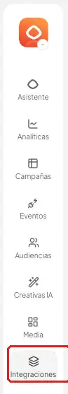
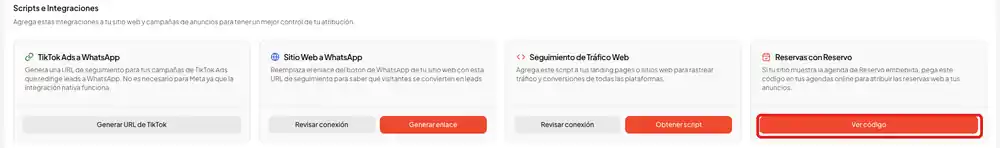
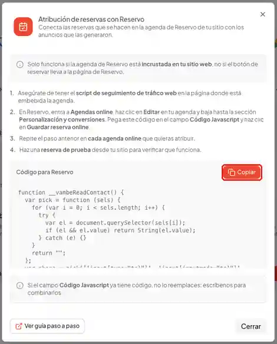
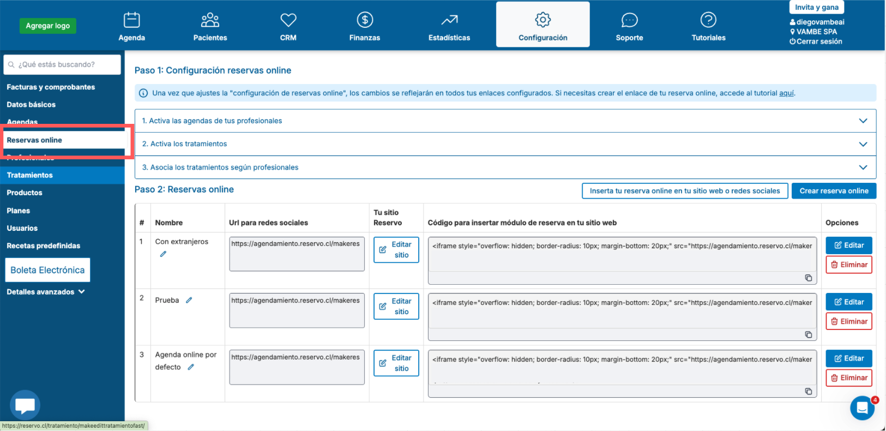
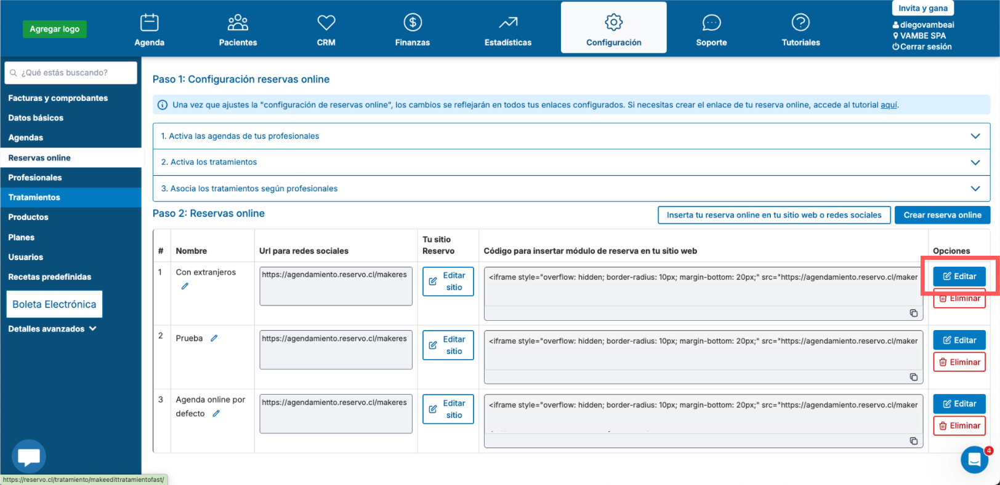
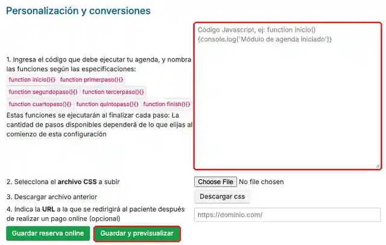

# Reservo: cómo obtener la atribución de reservas

Si tu sitio web muestra la agenda de Reservo, Vambe Ads puede conectar cada reserva web con el anuncio que trajo a esa persona. Así sabes qué campañas generan reservas reales y no solo visitas.

En este artículo aprenderás qué necesitas para que la atribución funcione y cómo configurar tus agendas online de Reservo.

## ¿Para qué sirve?

* Saber qué campaña, conjunto o anuncio generó cada reserva hecha desde tu sitio.
* Medir el costo por reserva y el rendimiento real de tus anuncios.

***

## Qué necesitas para que funcione

La atribución solo funciona si la agenda de Reservo está **incrustada en tu sitio web**, es decir, si la persona reserva sin salir de tu página.

* **Funciona:** la agenda de Reservo aparece dentro de una página de tu sitio (por ejemplo, `tusitio.cl/agenda`).
* **No funciona:** el botón "Reservar" lleva a la página de Reservo (`agendamiento.reservo.cl`). En ese caso, Vambe no puede ver la reserva.


¿No sabes cómo está tu agenda? Abre tu sitio y haz clic en "Reservar". Si la dirección del navegador sigue siendo la de tu sitio, la agenda está incrustada.


Además, necesitas tener el **script de seguimiento de tráfico web** en la página donde está la agenda. Si aún no lo tienes, sigue el paso a paso de "Insertar el script de seguimiento web" en el artículo [Meta Ads: cómo obtener una atribución correcta](meta-ads-como-obtener-una-atribucion-correcta.md).

***

## Paso a paso



#### Copia el código para Reservo

En el menú de la izquierda de Vambe Ads, ve a **Integraciones**.

<figure><figcaption></figcaption></figure>

Busca la tarjeta **Reservas con Reservo** y haz clic en **Ver código**.

<figure><figcaption></figcaption></figure>

Se abrirá una ventana con el código. Haz clic en **Copiar**.

<figure><figcaption></figcaption></figure>



#### Abre tu agenda online en Reservo

Ingresa a tu cuenta de Reservo y entra a **Agendas online**.

<figure><figcaption></figcaption></figure>

Haz clic en **Editar** en la agenda que muestras en tu sitio.

<figure><figcaption></figcaption></figure>



#### Pega el código

* Baja hasta la sección **Personalización y conversiones**.
* Pega el código en el campo **Código Javascript**.
* Haz clic en **Guardar y previsualizar**.

<figure><figcaption></figcaption></figure>


Si el campo Código Javascript ya tiene código, no lo reemplaces. Escríbenos y te ayudamos a combinarlos.




#### Repite en cada agenda

Repite los pasos 2 y 3 en cada agenda online que quieras atribuir. Las agendas sin el código no enviarán sus reservas a Vambe.



#### Haz una reserva de prueba

* Entra a tu sitio, abre la agenda y haz una reserva de prueba.
* Si tienes dudas sobre el resultado, escríbenos y lo revisamos contigo.



***

## En resumen

Con la agenda de Reservo incrustada en tu sitio, el script de seguimiento web instalado y el código pegado en cada agenda online, Vambe Ads conecta cada reserva con el anuncio que la generó. Así puedes medir el costo por reserva y decidir con datos qué campañas vale la pena potenciar.
